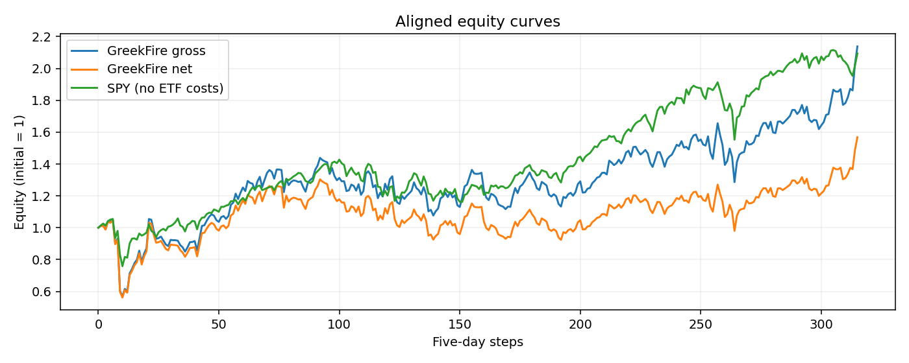
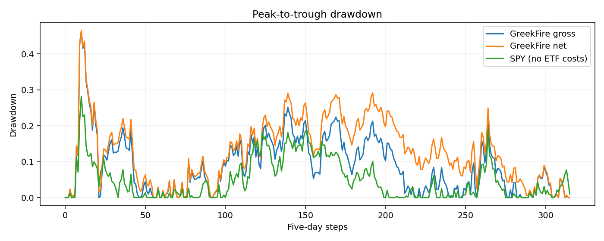

# GreekFire: historical research results

> Historical preparation record. Superseded for current methodology by the [October 30 audit](../docs/AUDIT_2026-10-30.md). Numbers and unresolved-code descriptions below refer to the earlier implementation.

**Snapshot:** 2026-09-30. These are simulated results from local data, not live trades, verified alpha, or an independently held-out test. See the [research audit](RESEARCH_AUDIT.md) for the full methodological record.

## Study

The reference configuration ranks historical S&P 500 stocks using a seeded Random Forest/XGBoost ensemble. It retrains on a rolling 252-trading-session window, then selects ten sector-capped, equally weighted long positions every five trading sessions. Signals use information through the signal close; returns assume entry at the next adjusted open and exit at the fifth adjusted close. Shorts and regime switching are disabled. Source prices and historical membership CSVs are local inputs and are not redistributed here.

The matched 2020-01-07 to 2026-04-08 comparison has **315 five-session steps**. Net GreekFire returns assume 10 basis points of transaction costs plus 5 basis points of slippage per unit of one-way portfolio turnover, including initial entry. SPY uses matching price windows but excludes ETF trading costs. Annualized Sharpe and Sortino below use a zero risk-free rate; the [audit](RESEARCH_AUDIT.md) separately records the engine's 5% risk-free-rate convention.

| Same 315 dates | CAGR | Annual volatility | Sharpe | Sortino | Maximum drawdown | Calmar | Cumulative return |
| --- | ---: | ---: | ---: | ---: | ---: | ---: | ---: |
| GreekFire gross | 12.93% | 30.57% | 0.56 | 0.78 | 46.14% | 0.28 | 113.82% |
| GreekFire net | 7.47% | 30.57% | 0.40 | 0.55 | 46.42% | 0.16 | 56.83% |
| SPY (uncosted) | 12.56% | 18.69% | 0.73 | 1.01 | 28.11% | 0.45 | 109.43% |

## Sensitivity

| Total cost per unit one-way turnover | GreekFire CAGR | Sharpe (rf=0) | Maximum drawdown |
| ---: | ---: | ---: | ---: |
| 0 bps | 12.93% | 0.56 | 46.14% |
| 15 bps | 7.47% | 0.40 | 46.42% |
| 30 bps | 2.26% | 0.23 | 46.70% |

On the same 315 dates, shortening training from 252 to 126 trading sessions changed net CAGR from **+7.47% to -2.65%**; maximum drawdown was 46.42% versus 47.81%. The remaining full-period tests (five longs, alternative weighting, and 75/25 model blending) were not completed within the laptop compute budget. Short smoke runs are not full-period evidence.

The observed mean net-minus-SPY return was -0.029% per five-session step. An exploratory 12-step moving-block bootstrap gave a 95% interval of [-0.328%, 0.254%]. This is **not** a multiple-testing-adjusted significance test. Realized SPY-up/down groupings in the generated report are descriptive, not information available when selecting trades.

## Interpretation

The net strategy trailed aligned SPY on return, risk-adjusted return, and drawdown under these assumptions. The full default main configuration is different (one long, rank/inverse-vol weighting) and returned **-3.38% net CAGR with 96.65% maximum drawdown** over its 856 valid 2009-2026 steps; it must not be conflated with the ten-long study above.

**Critical unresolved bias:** feature rows currently require a finite *future* target. Stocks without an available exit price can disappear before test-time selection, particularly near delisting. Together with globally blacklisted historical constituents, merger-to-successor ticker mappings, unverified delisting payoffs, prior tuning on these dates, and simplified costs, this means none of the quoted returns is an investable estimate. No missing outcomes were fabricated to fill this gap.

Reproduce with local licensed market inputs: `julia --threads=1 --project=. main.jl validate`, then `python research_report.py`. The report generator writes the detailed local report and plots under `octave/`; compare its method, period, and figures with this dated snapshot. The full command and input requirements are in the [README](../README.md).