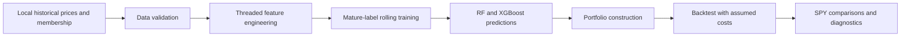

# GreekFire

GreekFire is an independently developed Julia framework for investigating whether historical stock-market features contain useful predictive information. It combines feature engineering, Random Forest and XGBoost models, and walk-forward portfolio simulation. The central question is whether a model can rank future stock returns under an evaluation that respects when information becomes available.

## Motivation

A high backtest return is easy to misinterpret. Historical prices can contain broken security identities, incomplete outcomes and changing index membership. I built this project to explore prediction while learning how to check the evaluation itself. The experiment history records unsuccessful approaches as well as promising-looking results that later required investigation.

## System Architecture



The current audit, [technical findings](docs/AUDIT_2026-10-30.md) and [validation record](docs/VALIDATION_2026-10-30.md), explain what the tests establish and what remains unresolved.

## Technical Implementation

Julia modules separate local CSV loading, feature calculations, model fitting, accounting and exports. Feature generation runs across stocks using Julia threads. Momentum, moving-average distance, volatility, relative momentum and volume features use trailing observations. Same-date percentile ranks are calculated after historical membership filtering. These are cross-sectional transformations, not normalization fitted over future dates.

Each step fits a 50-tree Random Forest, a 150-round XGBoost model and a linear regression reference. The default ensemble averages RF and XGBoost predictions. Fixed seeds support repeatable experiments; the models use library implementations. A momentum mode runs a simple 20-session ranking through the same portfolio engine. Feature importance is Random Forest impurity importance, a descriptive diagnostic rather than evidence of causal or stable predictive value.

## Experimental Methodology

The default training window spans 252 benchmark sessions. Signals use information through the signal close. Training ends at the preceding session and includes only finite labels whose exit dates have already passed. Entry is the next adjusted open; exit is the fifth benchmark-session close after the signal. Signals recur every five sessions. Positions are liquidated at exit and cash earns zero until the next entry, so adjacent windows do not overlap.

The default main program holds one stock; historical validation defaults to ten requested stocks with equal weights. Sector limits are two names per mapped sector and three for the shared unknown group. Fewer names may be selected. Position caps can leave cash. The sector map is incomplete and is not a verified historical classification feed.

Costs default to 10 basis points transaction cost plus 5 basis points slippage **per traded dollar**, charged on entry and liquidation notional. Gross and net returns are exported. These are configurable assumptions, not inferred execution prices. SPY comparisons use actual local prices over identical entry/exit windows, excluding SPY trading costs. This is a matched-window benchmark, not continuous SPY buy-and-hold.

Historical membership uses inclusive start/end dates; blank end means active. The input provider must confirm this boundary convention. Security symbols remain separate: acquired companies are not replaced with their buyers. Unknown future outcomes stay in signal rows; the engine refuses missing forward outcomes instead of replacing candidates. Missing security files also stop the historical loader. These checks do not certify the underlying data.

CAGR compounds simple five-session returns at 252/5 periods per year. Sharpe uses sample standard deviation and a zero risk-free rate by default. Drawdown includes initial capital. Mean return and mean strategy-minus-SPY return are separate fields; undefined statistics remain NaN. Drawdowns measured only at rebalance exits can miss larger intraperiod losses.

## Results

**No corrected historical performance estimate is available.** The October 30 audit executed the synthetic model pipeline, but a historical smoke run stopped at an invalid `ABS.csv` header. A structural inventory found 529 missing symbol files among 1,194 historical symbols. Membership provenance and complete corporate-action histories are also unverified.

| Evidence | Current status |
| --- | --- |
| Synthetic features and full model/portfolio integration | Tested locally; see validation record |
| Corrected historical backtest | Blocked by incomplete and malformed inputs |
| Untouched out-of-sample evaluation | Not available; past dates informed research decisions |
| Earlier financial returns | Preserved, historical and unvalidated |

Run 77 reported 84.2% CAGR with mean rank IC of -0.0049. Those summary numbers do not establish a predictive edge. The [research notes](RESEARCH_NOTES.md) explain why the claim cannot be accepted. Earlier reruns and figures remain in [the dated archive](CHANGELOG/RESEARCH_RESULTS_2026-09-30.md); they predate the present corrections and are not current findings. No new market-performance chart is presented without valid corrected inputs.

## What I Learned

Small implementation choices change what a backtest measures. Comparing symbol names with string column names can disable a membership boundary. Filtering rows for known future returns can remove the very failures a simulation needs to measure. A model can also produce a profitable-looking concentrated portfolio while its overall ranking has little relationship to subsequent returns.

The history includes an HMM regime experiment, changing portfolio rules and weak ranking diagnostics. It supports a lesson about keeping research records and checking simpler explanations before trusting a result. The current priority is reproducible accounting and complete security histories. [Research notes](RESEARCH_NOTES.md) distinguish recorded observations from interpretations that still need evidence.

## Reproduction Instructions

Use Julia 1.12.4, the version recorded in `Manifest.toml`, and Python 3.12 for helper checks. Internet access is needed to install Julia packages; no paid data or network access is required for the synthetic tests. XGBoost's native dependency is supplied through Julia artifacts. GNU Octave is optional.

```text
julia --project=. -e "using Pkg; Pkg.instantiate()"
julia --threads=1 --project=. test/runtests.jl
julia --threads=1 --project=. examples/synthetic_backtest.jl
python -m unittest discover -s tests -p "test_*.py" -v
python research_report.py --self-test
python robustness_matrix.py --self-test
python risk_overlay_study.py --self-test
python tools/check_repository.py
```

The synthetic example creates invented prices in memory and writes a small output under ignored `results/synthetic/`. Its returns are software fixtures, not evidence of market performance. GitHub Actions runs the public checks on push and pull requests.

For market data, follow the [schema and provenance instructions](docs/INPUTS.md). No market dataset is distributed. The optional [recovery tool](docs/DATA_RECOVERY.md) records provenance for new downloads but cannot certify the original cache. Once complete, verified inputs are supplied:

```text
python tools/audit_data.py
julia --threads=1 --project=. main.jl validate --max-steps=2
julia --threads=1 --project=. main.jl validate
julia --threads=1 --project=. main.jl validate --prediction-mode=momentum
python research_report.py
python robustness_matrix.py                 # prints predefined sensitivity commands
python robustness_matrix.py --run           # expensive; only after fixing data
```

Archive each configuration's outputs before running the next. New validation and main exports go to `results/corrected/` and carry methodology `corrected-v2`. The old `EXPERIMENT_LOG.md` is preserved; new main-run notes go to the corrected output directory. Python report figures require `python -m pip install -r requirements-report.txt`. For Octave, run `octave/plot_all.m` after a main export. The legacy analysis scripts are described in the repository map below.

## Repository Structure

| Path | Purpose |
| --- | --- |
| `data_loader.jl`, `features.jl` | Local schema checks, membership, features and label metadata |
| `model.jl`, `backtest.jl` | Model fitting, trading schedule, portfolio simulation |
| `metrics.jl`, `validation.jl` | Arithmetic metrics, selected-period reporting and exports |
| `main.jl`, `visualizer.jl` | CLI and diagnostic CSV exports |
| `test/`, `examples/` | Deterministic tests and complete synthetic integration |
| `tools/` | Data inventory, repository checks and optional price recovery |
| `research_report.py`, `robustness_matrix.py` | Corrected-export reporting and fixed sensitivity configurations |
| `EXPERIMENT_LOG.md`, `CHANGELOG/` | Original exploratory history and dated reports |
| `regime.jl`, `hmm.jl` | Disabled experimental HMM; not loaded by main |
| `momentum_baseline.jl` | Convenience entrypoint for corrected momentum validation |
| `archive/`, `analyze_greekfire.py`, `risk_overlay_study.py` | Preserved legacy studies; not current evaluation entrypoints |

## Limitations and Future Work

A historical membership table alone does not eliminate survivorship bias. The original cache lacks independently verified membership provenance, stable security identifiers, acquisition payouts and delisting returns. The structural inventory cannot prove historical completeness. Adjusted prices assume coherent vendor adjustment factors; volume features and liquidity also need scrutiny.

The experiments repeatedly used the same historical periods. Hyperparameters are exploratory, not independently selected. A credible next study needs verified data, a frozen specification and a new evaluation period. It should compare the model with momentum under identical constraints, examine cost sensitivity and period dependence, and quantify ranking uncertainty with dependence-aware methods. No profitability, institutional maturity or live performance is claimed.
